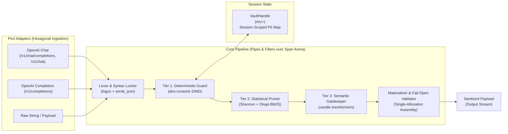
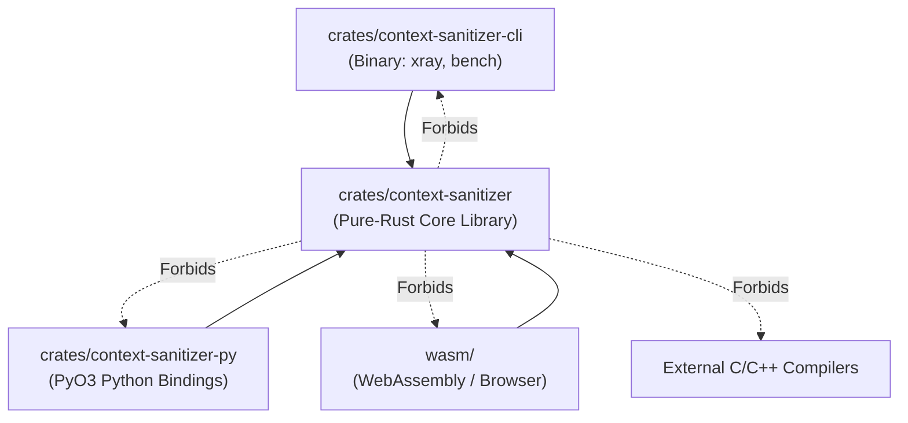

# Architecture Spine — context-sanitizer

## Design Paradigm

`context-sanitizer` is structured as a **Span-Annotated Pipes-and-Filters Cascade within a Hexagonal Envelope**. 

The core processing engine operates as an ordered sequence of zero-allocation, read-only scanners over an immutable input buffer, producing a non-overlapping span arena that is materialized in a single final allocation. External wire protocols (`POST /v1/chat/completions`, `POST /v1/chat`, `POST /v1/completions`) and platform bindings (Python PyO3, CLI, WebAssembly) interface with the engine strictly through decoupled port adapters.



---

## Invariants & Rules



### AD-1 — Span-Annotated Pipes-and-Filters Cascade

- **Binds:** `all`, `FR-1`, `FR-2`, `FR-3`, `FR-4`, `FR-5`, `FR-6`, `FR-8`
- **Prevents:** Heap reallocation churn, UTF-8 character boundary corruption, and pipeline order bypasses (e.g. pruning exposing redacted secret entropy).
- **Rule:** Scanners execute strictly as read-only passes producing non-overlapping byte `Span` markers over an immutable payload buffer. Redaction spans have absolute priority over compression spans. Secrets are fail-closed; structural formatting is fail-open.

### AD-2 — Pure-Rust Core Isolation & Unidirectional Workspace Dependencies

- **Binds:** `all`, `FR-10`, `FR-11`, `FR-12`, `FR-13`
- **Prevents:** Circular dependencies, bloated release binaries, and cross-compilation wheel failures.
- **Rule:** The core library crate (`context-sanitizer`) must be pure Rust with `#![forbid(unsafe_code)]` in parsing cores and zero external C/C++ toolchain dependencies, compiling cleanly for native architectures (`x86_64`, `aarch64`) and WebAssembly (`wasm32-unknown-unknown`, `wasm32-wasip1`). User-facing surfaces (`cli`, `py`, `wasm`) depend unidirectionally on Core; Core depends on none of them.

### AD-3 — Session-Scoped Thread-Safe Vault with Whitelisted Rehydration

- **Binds:** `FR-2`, `FR-3`
- **Prevents:** Cross-tenant PII token collision, multi-threaded race conditions, and indirect prompt injection exfiltration to external webhooks.
- **Rule:** `VaultHandle` wraps `Arc<RwLock<VaultInner>>` utilizing a per-session 128-bit cryptographic random salt and zero disk persistence. Rehydration via `.rehydrate(args, destination)` requires an authorized destination matching a registered tool whitelist; unregistered destinations reject rehydration.

### AD-4 — Fail-Open Syntax Verification Invariant

- **Binds:** `FR-4`, `FR-6`
- **Prevents:** Downstream LLM HTTP 400 crashes caused by broken JSON escape sequences, unclosed code fences, or stripped commas.
- **Rule:** Structural JSON delimiters, markdown code fences, inline shell backticks, subshells, and environment variables receive immutable byte locks pre-pruning; post-compression output must pass `serde_json::from_str` verification or fail-open to uncompressed text with secrets remaining permanently masked.

### AD-5 — Trait Decoupling and CPU Fallback for ML Gatekeeping

- **Binds:** `FR-7`, `FR-8`, `FR-9`
- **Prevents:** Mandatory multi-gigabyte PyTorch/Candle dependencies in standard builds and host application panics on unsupported CPU hardware.
- **Rule:** Core defines `pub trait SemanticGuard` and `pub trait TokenCompressor`. Candle inference is conditionally compiled behind `--features ml`. If model weights are missing, corrupted, or inference fails, the engine logs a non-fatal warning and falls back to Tier 2 statistical compression without crashing host processes.

---

## Consistency Conventions

| Concern | Convention |
| :--- | :--- |
| **Naming (Rust Types)** | `PascalCase` for types and traits (`VaultHandle`, `Span`, `SpanKind`, `SemanticGuard`, `TokenCompressor`). |
| **Naming (Rust Functions)** | `snake_case` for modules and methods (`sanitize_payload`, `rehydrate`, `evaluate_threat`). |
| **Shadow Token Format** | `<SHADOW:<TYPE>_<HEX6>>` (e.g., `<SHADOW:EMAIL_8f3a2c>`, `<SHADOW:IP_4d91b0>`, `<SHADOW:PHONE_2a1b9e>`). |
| **Redaction Mask Format** | `[REDACTED_CREDENTIAL]` for all irreversible secrets. |
| **Error Handling** | `thiserror` library enums (`SanitizerError::SyntaxLockViolation`, `SanitizerError::UnauthorizedRehydration`). No panics in library code. |
| **Wire Protocol Fields** | Exact OpenAI JSON schema parity (`messages`, `role`, `content`, `tools`, `tool_calls`). Wire paths: `POST /v1/chat/completions`, `POST /v1/chat`, `POST /v1/completions`. |
| **Licensing Policy** | MIT License for all workspace crates. All third-party dependencies must be commercially permissive (MIT, Apache-2.0, or BSD-3-Clause) and explicitly listed in `README.md`. |

---

## Stack

| Name | Version |
| :--- | :--- |
| **Rust Edition** | `2021` (MSRV 1.80+) |
| **`aho-corasick`** | `1.1.5` |
| **`logos`** | `0.16.1` |
| **`serde`** | `1.0.210` |
| **`serde_json`** | `1.0.128` |
| **`candle-core`** (`--features ml`) | `0.11.0` |
| **`candle-transformers`** (`--features ml`) | `0.11.0` |
| **`tokenizers`** (`--features ml`) | `0.20.0` |
| **`clap`** | `4.5.20` |
| **`pyo3`** | `0.23.0` |
| **`maturin`** | `1.7.4` |
| **`wasm-bindgen`** | `0.2.95` |
| **`thiserror`** | `1.0.64` |

---

## Structural Seed

### Workspace Layout

```text
context-sanitizer/
├── Cargo.toml                    # Root workspace configuration
├── crates/
│   ├── context-sanitizer/        # Core pure-Rust library
│   │   ├── Cargo.toml
│   │   └── src/
│   │       ├── lib.rs            # Public API, error types, pipeline runner
│   │       ├── arena.rs          # Span-annotated zero-copy buffer arena
│   │       ├── guard/            # Tier 1: SIMD secret patterns, entropy, VaultHandle
│   │       │   ├── mod.rs
│   │       │   ├── patterns.rs   # Multi-cloud keys, *_KEY heuristics, PII regexes
│   │       │   ├── entropy.rs    # Pure-Rust Shannon entropy (H >= 4.5)
│   │       │   └── vault.rs      # Session-scoped VaultHandle & destination whitelisting
│   │       ├── compress/         # Tier 2: Lexical syntax locking, Shannon, BM25, schema minifier
│   │       │   ├── mod.rs
│   │       │   ├── lexer.rs      # logos syntax token locking (JSON, code fences, shell backticks)
│   │       │   ├── shannon.rs    # Static unigram self-information I(w) = -log P(w)
│   │       │   ├── bm25.rs       # Okapi BM25 tail-query scoring
│   │       │   ├── submodular.rs # Budgeted knapsack chunk selection
│   │       │   └── schema.rs     # JSON tool schema minifier
│   │       ├── ml/               # Tier 3: Trait definitions & Candle inference (--features ml)
│   │       │   ├── mod.rs
│   │       │   ├── traits.rs     # pub trait SemanticGuard & TokenCompressor
│   │       │   ├── candle.rs     # Candle encoder runner (DeBERTa / Prompt Guard 2)
│   │       │   └── chunking.rs   # 512-token sliding window with stride alignment
│   │       └── wire/             # Wire serialization
│   │           ├── mod.rs
│   │           ├── chat.rs       # /v1/chat/completions and /v1/chat models
│   │           └── completion.rs # /v1/completions prompt models
│   ├── context-sanitizer-cli/    # Standalone binary crate (CLI & benchmarks)
│   │   ├── Cargo.toml
│   │   └── src/
│   │       ├── main.rs           # Entry point
│   │       ├── xray.rs           # Terminal visualization (tables, colors, savings math)
│   │       └── bench.rs          # Deterministic benchmarks (MeetingBank, GSM8K)
│   └── context-sanitizer-py/     # PyO3 Python bindings crate
│       ├── Cargo.toml
│       ├── pyproject.toml
│       ├── src/
│       │   └── lib.rs            # PyO3 exports: sanitize, rehydrate, VaultHandle
│       └── python/
│           └── context_sanitizer/
│               ├── __init__.py
│               └── integrations/ # Turnkey middleware wrappers
│                   ├── langchain.py
│                   ├── crewai.py
│                   └── autogen.py
├── wasm/                         # WebAssembly package (@context-sanitizer/wasm)
│   ├── package.json
│   └── src/
│       └── lib.rs                # wasm-bindgen exports for browser/edge runtimes
└── benches/                      # Criterion microbenchmarks
    └── pipeline_throughput.rs
```

### Core Rust Entity Signatures

```rust
pub struct Span {
    pub start: usize,
    pub end: usize,
    pub kind: SpanKind,
}

pub enum SpanKind {
    Locked,
    Redacted(&'static str),
    Shadow(String),
    Pruned,
    Retained,
}

pub struct VaultHandle {
    inner: Arc<RwLock<VaultInner>>,
}

struct VaultInner {
    forward: HashMap<String, String>,
    reverse: HashMap<String, String>,
    whitelist: HashSet<String>,
    salt: [u8; 16],
}

#[async_trait]
pub trait SemanticGuard: Send + Sync {
    async fn evaluate_threat(&self, text: &str) -> Result<f32, SanitizerError>;
}

pub trait TokenCompressor: Send + Sync {
    fn compress(&self, payload: &str, target_rate: f32) -> Result<String, SanitizerError>;
}
```

---

## Capability → Architecture Map

| Capability / Area | Lives in | Governed by |
| :--- | :--- | :--- |
| **FR-1: Credential Interception** | `crates/context-sanitizer/src/guard/patterns.rs`, `entropy.rs` | AD-1 (Redaction priority), AD-2 (Pure Rust) |
| **FR-2: PII Shadow Vaulting** | `crates/context-sanitizer/src/guard/vault.rs` | AD-3 (Session-scoped isolation) |
| **FR-3: Whitelisted Rehydration** | `crates/context-sanitizer/src/guard/vault.rs` | AD-3 (Destination whitelist) |
| **FR-4: Syntax Locking & Fail-Open** | `crates/context-sanitizer/src/compress/lexer.rs` | AD-1 (Span arena), AD-4 (Fail-open) |
| **FR-5: Statistical Pruning** | `crates/context-sanitizer/src/compress/shannon.rs`, `bm25.rs` | AD-1 (Read-only span markings) |
| **FR-6: JSON Schema Minification** | `crates/context-sanitizer/src/compress/schema.rs` | AD-4 (JSON schema preservation) |
| **FR-7: Decoupled ML Traits** | `crates/context-sanitizer/src/ml/traits.rs` | AD-5 (Pluggable traits) |
| **FR-8: Encoder Threat Scoring** | `crates/context-sanitizer/src/ml/candle.rs`, `chunking.rs` | AD-5 (Sliding-window Candle runner) |
| **FR-9: Fault-Tolerant Fallback** | `crates/context-sanitizer/src/ml/mod.rs` | AD-5 (Zero-crash fallback to Tier 2) |
| **FR-10: OpenAI Wire Ingestion** | `crates/context-sanitizer/src/wire/` | Consistency Conventions (OpenAI Parity) |
| **FR-11: Zero-C Python Wheel** | `crates/context-sanitizer-py/` | AD-2 (Maturin precompiled wheels) |
| **FR-12: Context X-Ray CLI** | `crates/context-sanitizer-cli/` | AD-2 (Unidirectional dependency) |
| **FR-13: Universal Wasm Package** | `wasm/` | AD-2 (Pure-Rust Wasm compilation) |

---

## Deferred

| Item | Reason for Deferral |
| :--- | :--- |
| **Streaming Token Chunk Compression** | Requires maintaining stateful lexical window buffers across chunk boundaries. Can be layered in v2 without breaking the batch API. |
| **Cross-Restart Persistent Vaults** | Ephemeral in-memory vaults eliminate disk encryption overhead and cross-tenant leakage. Persistent vaults belong in enterprise storage layers. |
| **Distributed Multi-Node Vault Sync** | A local proxy architecture operates per-instance with zero network hops. Multi-node cluster replication is deferred to centralized gateway tiers. |
